# Kermesse — Modelo lógico de datos E-R

**Versión:** 0.4
**Estado:** modelo lógico con primera persistencia local en MariaDB
**Fecha:** 2026-10-30
**Motor productivo:** pendiente; entorno local detectado MariaDB 10.4.18
**Alcance:** modelo lógico; identidad, acceso e idempotencia ya cuentan con migraciones locales, mientras los módulos operativos siguen como diseño.

## 1. Principios del modelo

- Toda tabla operativa lleva `organization_id` y, cuando corresponde, `event_id`.
- Las claves primarias son UUID en el dominio. Su representación física se decidirá con el motor; las fechas se guardan en UTC mediante tipos compatibles con el ORM.
- Los importes usan `numeric(14,2)` y moneda explícita (`currency`, inicialmente `BOB`).
- El acceso se filtra siempre por organización y evento; no se confía únicamente en la URL o en la interfaz.
- Las ventas conservan una instantánea del precio y descripción del producto; cambiar el catálogo no cambia ventas históricas.
- Las escrituras críticas se ejecutan dentro de una transacción y registran `audit_logs`.
- Las operaciones reintentables registran `idempotency_keys` con alcance por organización, usuario, método y ruta.
- Un evento cerrado conserva sus datos y permite lecturas autorizadas, pero sus agregados operativos no se modifican.
- La plataforma es centralizada y separa los cobros por uso de Kermesse de los pagos internos de cada evento.
- La facturación tributaria se implementará en una segunda etapa; la primera solo reserva la asociación opcional entre evento y entidad emisora.

## 2. Diagrama E-R lógico

```mermaid
erDiagram
    ORGANIZATIONS ||--o{ ORGANIZATION_MEMBERSHIPS : has
    USERS ||--o{ ORGANIZATION_MEMBERSHIPS : belongs
    ORGANIZATION_MEMBERSHIPS ||--o{ ORGANIZATION_MEMBERSHIP_ROLES : receives
    ROLES ||--o{ ORGANIZATION_MEMBERSHIP_ROLES : grants
    ORGANIZATIONS ||--o{ EVENTS : owns
    ORGANIZATIONS ||--o{ EVENT_ORDERS : purchases
    EVENTS ||--o| EVENT_ENTITLEMENTS : enabled_by
    EVENT_ORDERS ||--o{ PLATFORM_PAYMENTS : paid_with
    EVENT_ORDERS ||--|| EVENT_ENTITLEMENTS : grants
    ORGANIZATIONS ||--o{ TAX_ISSUERS : registers
    EVENTS ||--o| EVENT_TAX_CONFIGS : configures
    TAX_ISSUERS ||--o{ EVENT_TAX_CONFIGS : emits_for
    USERS ||--o{ EVENT_MEMBERSHIPS : receives
    EVENTS ||--o{ EVENT_MEMBERSHIPS : includes
    EVENT_MEMBERSHIPS ||--o{ EVENT_MEMBERSHIP_ROLES : receives
    ROLES ||--o{ EVENT_MEMBERSHIP_ROLES : grants
    EVENT_MEMBERSHIPS ||--o{ EVENT_PERMISSION_GRANTS : delegates
    PERMISSIONS ||--o{ EVENT_PERMISSION_GRANTS : grants
    ROLES ||--o{ ROLE_PERMISSIONS : contains
    PERMISSIONS ||--o{ ROLE_PERMISSIONS : enables
    ORGANIZATIONS ||--o{ ACCESS_INVITATIONS : issues
    EVENTS ||--o{ ACCESS_INVITATIONS : may_target
    USERS ||--o{ ACCESS_INVITATIONS : invites

    EVENTS ||--o{ EVENT_PRODUCTS : offers
    EVENTS ||--o{ COURSE_GROUPS : organizes
    EVENT_PRODUCTS ||--o{ TICKET_ALLOCATIONS : allocated
    COURSE_GROUPS ||--o{ TICKET_ALLOCATIONS : receives
    USERS ||--o{ TICKET_ALLOCATIONS : responsible

    EVENTS ||--o{ CUSTOMERS : has
    EVENTS ||--o{ SALES : records
    CUSTOMERS ||--o{ SALES : places
    USERS ||--o{ SALES : operates
    SALES ||--|{ SALE_ITEMS : contains
    EVENT_PRODUCTS ||--o{ SALE_ITEMS : sold
    SALES ||--o{ PAYMENTS : paid_by
    PAYMENTS ||--o{ PAYMENT_EVIDENCES : supported_by
    SALES ||--o{ TICKETS : issues
    TICKETS ||--|{ TICKET_ITEMS : contains
    SALE_ITEMS ||--o{ TICKET_ITEMS : authorizes
    TICKETS ||--o{ TICKET_REDEMPTIONS : redeemed
    USERS ||--o{ TICKET_REDEMPTIONS : performs

    EVENTS ||--o{ EXPENSES : incurs
    USERS ||--o{ EXPENSES : records
    EVENTS ||--o{ AUDIT_LOGS : traces
    USERS ||--o{ AUDIT_LOGS : acts
    EVENTS ||--o{ CLOSURE_CHECKS : validates
    EVENTS ||--o| EVENT_CLOSURES : closes
    USERS ||--o{ EVENT_CLOSURES : confirms
    EVENTS ||--o{ EXPORT_JOBS : generates
    USERS ||--o{ EXPORT_JOBS : requests
    ORGANIZATIONS ||--o{ IDEMPOTENCY_KEYS : scopes
    USERS ||--o{ IDEMPOTENCY_KEYS : submits
    EVENTS ||--o{ NOTIFICATION_DELIVERIES : triggers
    SALES ||--o{ NOTIFICATION_DELIVERIES : informs
```

## 3. Entidades y campos principales

### 3.0 Comercialización de la plataforma

| Tabla | Campos principales | Restricciones e índices |
|---|---|---|
| `event_orders` | `id`, `organization_id`, `event_id`, `price_version`, `amount`, `currency`, `discount_total`, `status`, `purchased_at` | Una orden conserva las condiciones contratadas; estados `pending`, `paid`, `waived`, `cancelled`, `refunded`. |
| `platform_payments` | `id`, `event_order_id`, `provider`, `provider_reference`, `amount`, `currency`, `status`, `paid_at` | No se mezcla con `payments`, que representa cobros de compradores del evento. |
| `event_entitlements` | `id`, `event_id`, `event_order_id`, `status`, `activated_at`, `activated_by`, `reason` | `unique(event_id)`; habilita operación por compra, exoneración o activación administrativa. |
| `tax_issuers` | `id`, `organization_id`, `legal_name`, `nit`, `status`, `tax_metadata_json` | Preparación de etapa 2; `unique(organization_id,nit)`. No almacenar credenciales tributarias en esta tabla. |
| `event_tax_configs` | `event_id`, `tax_issuer_id`, `invoicing_enabled`, `configured_at` | Etapa 2; máximo una configuración activa por evento. En etapa 1 `invoicing_enabled=false`. |

### 3.1 Organización, identidad y permisos

| Tabla | Campos principales | Restricciones e índices |
|---|---|---|
| `organizations` | `id`, `name`, `slug`, `status`, `created_at`, `updated_at` | `unique(slug)`; no se elimina físicamente si tiene eventos. |
| `users` | `id`, `email`, `display_name`, `status`, `created_at`, `updated_at` | `unique(lower(email))`; no contiene credenciales de proveedor externo. |
| `organization_memberships` | `id`, `organization_id`, `user_id`, `status`, `valid_from`, `valid_until`, `created_at`, `updated_at` | `unique(organization_id,user_id)`; suspender o revocar bloquea todas las asignaciones de esa organización sin borrarlas. |
| `organization_membership_roles` | `organization_membership_id`, `role_id`, `granted_by`, `granted_at` | `primary key(organization_membership_id,role_id)`; solo admite roles con alcance `organization`. Un colaborador puede no tener rol administrativo. |
| `events` | `id`, `organization_id`, `name`, `slug`, `starts_at`, `ends_at`, `status`, `closed_at`, `created_at` | `unique(organization_id,slug)`; estados `draft`, `open`, `closed`, `cancelled`. |
| `roles` | `id`, `code`, `name`, `scope` | `unique(code)`; `scope` = `organization` o `event`. |
| `permissions` | `id`, `code`, `description` | `unique(code)`; catálogo técnico, no asignación directa al usuario. |
| `role_permissions` | `role_id`, `permission_id` | `primary key(role_id,permission_id)`; contiene únicamente permisos base `✓`, nunca delegaciones condicionadas `A`. |
| `event_memberships` | `id`, `event_id`, `user_id`, `access_type`, `status`, `valid_from`, `valid_until`, `created_at`, `updated_at` | `unique(event_id,user_id)`; `access_type` = `operational` o `historical`. La membresía histórica nunca habilita escritura. |
| `event_membership_roles` | `event_membership_id`, `role_id`, `granted_by`, `granted_at` | `primary key(event_membership_id,role_id)`; permite combinar roles y solo admite roles con alcance `event`. |
| `event_permission_grants` | `id`, `event_membership_id`, `permission_id`, `constraints_json`, `status`, `valid_from`, `valid_until`, `granted_by`, `created_at`, `revoked_at` | Representa permisos `A`; unicidad activa por membresía, permiso y restricción. No puede conceder `event.close` hasta aprobar la regla de cierre. |
| `access_invitations` | `id`, `organization_id`, `event_id`, `email_normalized`, `target_access_type`, `roles_json`, `status`, `token_hash`, `expires_at`, `invited_by`, `accepted_by`, `accepted_at`, `created_at` | El evento es opcional; las invitaciones de evento declaran roles explícitos. No guardar el token en texto plano. Una invitación aceptada se vuelve inmutable y no reemplaza la auditoría. |

`organization_memberships` es el límite del tenant y `event_memberships` es el límite operativo. Toda consulta de evento valida ambas relaciones. Los roles base se separan de las delegaciones adicionales para conservar denegación por defecto y trazabilidad.

La aceptación de una invitación debe ser transaccional: localizar o crear la identidad, activar la vinculación organizacional, crear la asignación de evento cuando corresponda, aplicar roles autorizados, marcar la invitación como aceptada y registrar auditoría. Una revocación organizacional deshabilita de forma lógica sus accesos de evento sin eliminar historial.

### 3.2 Catálogo, inventario y cursos

| Tabla | Campos principales | Restricciones e índices |
|---|---|---|
| `event_products` | `id`, `event_id`, `code`, `name`, `description`, `unit_price`, `currency`, `planned_quantity`, `status`, `version`, `created_at`, `updated_at` | `unique(event_id,code)`; `unit_price >= 0`, `planned_quantity >= 0`; `version` para concurrencia optimista. |
| `product_inventory` | `event_product_id`, `reserved_quantity`, `sold_quantity`, `version`, `updated_at` | `primary key(event_product_id)`; cantidades no negativas; actualizar con bloqueo/versionado. |
| `course_groups` | `id`, `event_id`, `code`, `name`, `responsible_user_id`, `status` | `unique(event_id,code)`; responsable pertenece al evento. |
| `ticket_allocations` | `id`, `event_id`, `course_group_id`, `event_product_id`, `responsible_user_id`, `quantity`, `status`, `created_at` | índices por evento/curso/producto; no crea ingreso ni venta. |

La disponibilidad se calcula como `planned_quantity - reserved_quantity - sold_quantity`, salvo que la organización apruebe otra política de reserva. La asignación de cursos queda separada del inventario comercial por defecto.

### 3.3 Compradores, ventas y pagos

| Tabla | Campos principales | Restricciones e índices |
|---|---|---|
| `customers` | `id`, `event_id`, `email`, `name`, `phone`, `created_at` | `unique(event_id,lower(email))` cuando exista correo; datos opcionales. |
| `sales` | `id`, `organization_id`, `event_id`, `customer_id`, `operator_user_id`, `channel`, `status`, `subtotal`, `discount_total`, `total`, `currency`, `confirmed_at`, `created_at` | índices por evento/estado/fecha; total no negativo; no borrar ventas confirmadas. |
| `sale_items` | `id`, `sale_id`, `event_product_id`, `product_code_snapshot`, `product_name_snapshot`, `unit_price_snapshot`, `quantity`, `line_total` | `quantity > 0`; `line_total = unit_price_snapshot * quantity`; índice por producto. |
| `payments` | `id`, `organization_id`, `event_id`, `sale_id`, `method`, `status`, `amount`, `currency`, `provider_reference`, `confirmed_at`, `created_at` | `unique(provider,provider_reference)` cuando exista; estados `pending`, `to_verify`, `confirmed`, `rejected`, `cancelled`, `refunded`. |
| `payment_evidences` | `id`, `payment_id`, `storage_key`, `sha256`, `submitted_by`, `submitted_at`, `reviewed_by`, `reviewed_at`, `status` | No guardar archivos sensibles en Git; `sha256` evita duplicados de comprobante. |

Una venta confirmada, su pago aplicable, el descuento/reserva de inventario, los tickets y la auditoría se confirman dentro de una única transacción local. Las llamadas a banco o correo no mantienen esa transacción abierta.

### 3.4 Tickets y canje

| Tabla | Campos principales | Restricciones e índices |
|---|---|---|
| `tickets` | `id`, `organization_id`, `event_id`, `sale_id`, `public_code`, `qr_hash`, `status`, `issued_at` | `unique(public_code)`, `unique(qr_hash)`; estados `issued`, `partially_redeemed`, `redeemed`, `void`. |
| `ticket_items` | `id`, `ticket_id`, `sale_item_id`, `event_product_id`, `quantity_issued`, `quantity_redeemed` | cantidades no negativas; `quantity_redeemed <= quantity_issued`. |
| `ticket_redemptions` | `id`, `ticket_id`, `event_id`, `operator_user_id`, `idempotency_key_id`, `quantity`, `redeemed_at`, `result` | índice por ticket/fecha; unicidad o bloqueo según política de canje parcial; nunca doble confirmación. |

La validación y el cambio de estado del ticket se ejecutan en la misma transacción y bloquean la fila del ticket o usan control de versión.

### 3.5 Gastos, reportes, cierre y auditoría

| Tabla | Campos principales | Restricciones e índices |
|---|---|---|
| `expenses` | `id`, `organization_id`, `event_id`, `category`, `description`, `amount`, `currency`, `expense_date`, `responsible_user_id`, `receipt_storage_key`, `status` | índices por evento/categoría/fecha; `amount >= 0`; comprobante opcional. |
| `audit_logs` | `id`, `organization_id`, `event_id`, `actor_user_id`, `action`, `aggregate_type`, `aggregate_id`, `request_id`, `metadata_json`, `created_at` | índices por evento/actor/fecha/acción; append-only. |
| `closure_checks` | `id`, `event_id`, `check_code`, `status`, `details_json`, `checked_at`, `checked_by` | `unique(event_id,check_code)` por revisión; estados `pending`, `passed`, `waived`. |
| `event_closures` | `id`, `event_id`, `closed_by`, `closed_at`, `balance_snapshot_json`, `snapshot_hash`, `notes` | `unique(event_id)`; registro inmutable del cierre. |
| `export_jobs` | `id`, `organization_id`, `event_id`, `requested_by`, `report_type`, `filters_json`, `format`, `status`, `storage_key`, `created_at`, `completed_at` | índices por evento/estado; permite exportaciones asíncronas. |

`balance_snapshot_json` conserva el resultado final aprobado. Su estructura debe versionarse para que un cambio futuro en criterios contables no altere el cierre histórico.

### 3.6 Idempotencia e integraciones

| Tabla | Campos principales | Restricciones e índices |
|---|---|---|
| `idempotency_keys` | `id`, `organization_id`, `event_id`, `user_id`, `idempotency_key`, `method`, `route(255)`, `request_hash`, `state`, `status_code`, `response_json`, `created_at`, `completed_at`, `expires_at` | `unique(organization_id,user_id,idempotency_key,method,route)`; rechazar misma clave con payload distinto y devolver la respuesta confirmada ante repetición o carrera. |
| `notification_deliveries` | `id`, `organization_id`, `event_id`, `aggregate_type`, `aggregate_id`, `channel`, `recipient`, `template`, `payload_json`, `token_key_version`, `status`, `attempts`, `provider_reference`, `next_attempt_at`, `last_error`, `lock_token`, `locked_at`, `created_at`, `sent_at` | único por agregado/canal/plantilla; índices por estado/fecha y lease; payload sin tokens planos y reintentos fuera de la transacción de negocio. |

Las credenciales y tokens de proveedores solo viven en variables de entorno o secret manager. `storage_key` apunta a almacenamiento controlado, no a contenido sensible dentro de la base si no es necesario.

## 4. Límites transaccionales

| Comando | Agregados bloqueados | Efectos atómicos |
|---|---|---|
| `CreateSale` | `sales`, `sale_items`, `event_products/product_inventory`, `idempotency_keys`, `audit_logs` | Venta, inventario y auditoría; el ticket se emite si el canal lo requiere. |
| `ConfirmPayment` | `payments`, `sales`, `tickets`, `idempotency_keys`, `audit_logs` | Estado de pago, habilitación/emisión del ticket y auditoría. |
| `RedeemTicket` | `tickets`, `ticket_items`, `ticket_redemptions`, `idempotency_keys`, `audit_logs` | Validación, descuento de cantidades y canje único. |
| `AssignTickets` | `ticket_allocations`, `idempotency_keys`, `audit_logs` | Asignación y auditoría; no venta ni ingreso. |
| `CloseEvent` | `events`, `closure_checks`, `event_closures`, `audit_logs` | Validaciones, instantánea, estado `closed` y bloqueo posterior. |

Los envíos de correo, llamadas al banco y generación de exportaciones no se ejecutan dentro de estas transacciones. Se registran como pendientes y se procesan con reintentos auditables.

## 5. Índices y restricciones mínimas

- Índices compuestos `(organization_id,event_id,created_at)` para ventas, pagos, gastos, auditoría y tickets.
- Índices filtrados o equivalentes compatibles con el motor para estados activos; no depender de índices parciales hasta elegir motor.
- Claves únicas por organización/evento para slugs, códigos de producto, grupos y claves de idempotencia.
- Restricciones `CHECK` para cantidades, importes y estados válidos.
- Claves foráneas con `ON DELETE RESTRICT` para ventas, pagos, tickets, auditoría y cierres.
- No usar eliminación física en datos financieros, tickets, canjes o auditoría; usar estados/anulación.
- Índices para autorización: `(organization_id,user_id,status)`, `(event_id,user_id,status)`, roles por membresía y delegaciones por vigencia.
- `email_normalized` se calcula en la aplicación y se protege con unicidad adecuada al motor para evitar diferencias de colación.

## 6. Reglas cubiertas y pendientes

| Regla | Soporte en el modelo |
|---|---|
| `RN-ORG-001`, `RN-EVT-001` | `organization_id`, `event_id`, membresías e índices compuestos. |
| `RN-PER-001`, `RN-PER-002` | membresías separadas, `access_type`, roles combinables, delegaciones explícitas y vigencias. |
| `RN-PRO-001`, `RN-PRO-002` | `event_products`, `product_inventory`, snapshots de `sale_items`. |
| `RN-VEN-002`, `RN-VEN-003` | límites transaccionales e `idempotency_keys`. |
| `RN-PAG-001`, `RN-PAG-002` | estados de `payments`, evidencias y entregas desacopladas. |
| `RN-TIC-001`, `RN-CAN-001` | unicidad de QR, `ticket_items` y canjes bloqueados. |
| `RN-GAS-001`, `RN-REP-001` | `expenses`, `export_jobs` y auditoría. |
| `RN-BAL-001`, `RN-BAL-002` | snapshot versionado; fórmula y reconocimiento contable aún requieren aprobación. |
| `RN-CIE-001` a `RN-CIE-003` | `closure_checks`, `event_closures` y estado cerrado. |
| `RN-PLT-001`, `RN-COM-001`, `RN-USR-001`, `RN-HIS-001` | aislamiento centralizado, órdenes/habilitaciones por evento, membresías sin precio por asiento e historial persistente. |
| `RN-FAC-001`, `RN-FAC-002` | `tax_issuers` y `event_tax_configs` reservan la etapa 2 sin emitir facturas en la etapa 1. |

Pendientes antes de crear la primera migración:

1. Confirmar motor y versión exacta; MySQL es el candidato principal y, si se elige, deberá utilizar InnoDB.
2. Aprobar reserva de inventario y política de asignaciones por curso.
3. Definir canje total o parcial y su unicidad.
4. Aprobar estados contables, mermas, sobrantes, saldos y snapshot del balance.
5. Confirmar retención de comprobantes, auditoría y notificaciones.
6. Definir precio, activación, cancelación, devolución y reprogramación de eventos.
7. Definir proveedor y modalidad tributaria antes de implementar la etapa 2 de facturación.
8. Definir quién puede cerrar un evento y si se requiere doble aprobación; `event.close` permanece denegado.
9. Elegir representación física de UUID, precisión temporal, estrategia de JSON, colaciones e índices compatibles con el motor.

## 7. Criterio de aprobación

El modelo se considera listo para convertirse en migraciones cuando cada tabla tenga propietario de contexto, cada escritura tenga comando transaccional, cada relación tenga autorización por organización/evento, el motor esté aprobado y los pendientes que afectan el primer esquema estén resueltos. Definir el responsable de cierre puede diferirse siempre que `event.close` continúe bloqueado y las tablas de cierre no se incluyan todavía en la primera migración.
