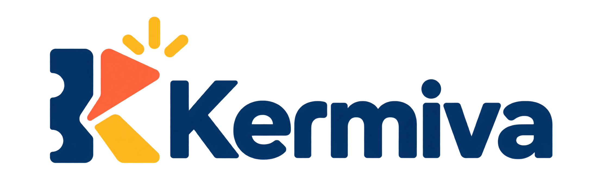
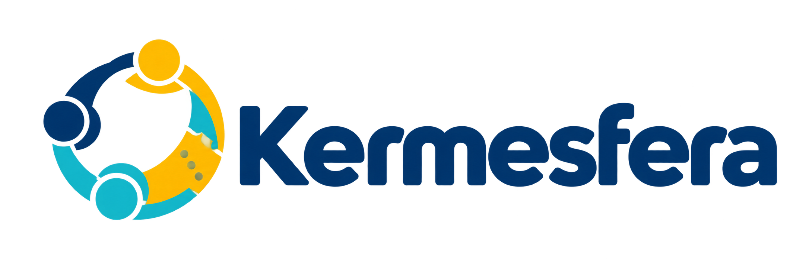
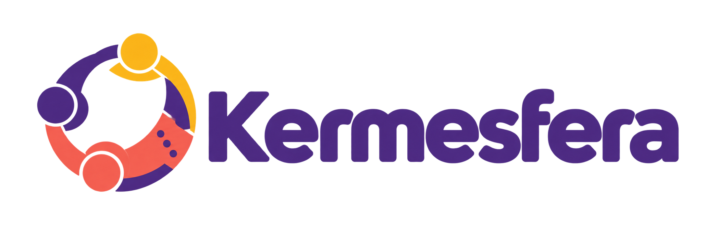
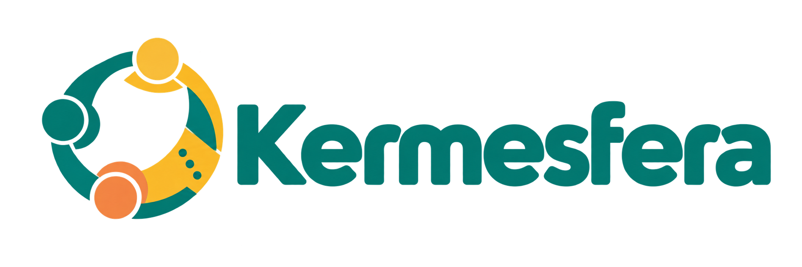
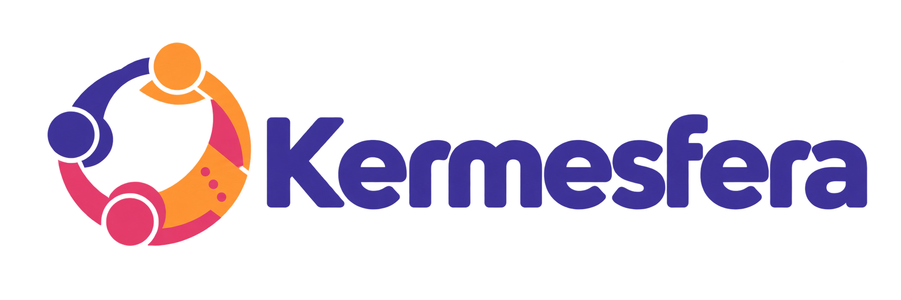
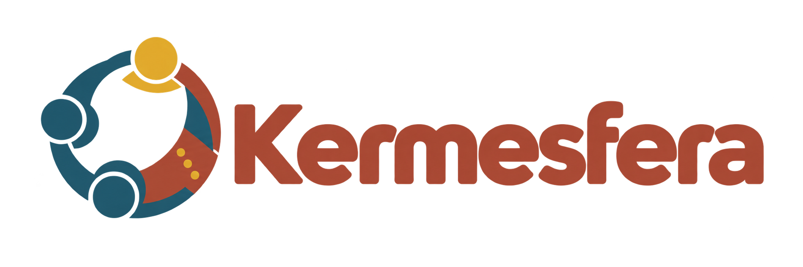

# Propuestas de marca para la plataforma de eventos

**Estado:** nombre comercial aprobado: **Kermesfera**; identidad visual en desarrollo
**Fecha:** 2026-10-29
**Empresa responsable:** Foreground System — <https://fsysbo.com/>

## Criterio visual compartido

Las cinco propuestas se diseñaron para convivir con la identidad de Foreground System: azul marino, amarillo luminoso, formas redondeadas y comunicación tecnológica cercana. Cada producto mantiene una identidad independiente y puede presentarse con el respaldo “Un producto de Foreground System”.

Los códigos siguientes son los colores propuestos para interfaces y futuras versiones vectoriales. Los PNG son conceptos generados y deben redibujarse en SVG antes de registrar o publicar una marca definitiva.

## Kermiva

| Uso | Color | HEX |
|---|---|---|
| Principal | Azul confianza | `#073B70` |
| Acción | Coral dinámico | `#FF6B4A` |
| Acento | Amarillo celebración | `#FFC928` |
| Fondo claro | Marfil | `#FFF9EE` |

Personalidad: rápida, comercial y tecnológica. Es la opción más adecuada si el producto seguirá asociado principalmente con kermesses.

## Kermesfera

| Uso | Color | HEX |
|---|---|---|
| Principal | Azul plataforma | `#063B73` |
| Acento principal | Amarillo | `#FFC400` |
| Secundario | Cian conexión | `#27C2D1` |
| Fondo claro | Blanco cálido | `#FAFAF5` |

Personalidad: ecosistema, organizaciones conectadas y plataforma completa. Es la que mejor se alinea visualmente con Foreground System.

## Eventario

| Uso | Color | HEX |
|---|---|---|
| Principal | Azul tinta | `#102A56` |
| Secundario | Violeta | `#7157D9` |
| Acción | Verde azulado | `#22B8A7` |
| Fondo claro | Gris lavanda | `#F6F5FC` |

Personalidad: organización, registro e historial. Es la opción más flexible si la plataforma crecerá hacia diferentes clases de eventos.

## Tinkuna

| Uso | Color | HEX |
|---|---|---|
| Principal | Azul noche | `#12345B` |
| Secundario | Terracota | `#E86A47` |
| Acento | Oro solar | `#F4B942` |
| Acción | Turquesa | `#25A9A0` |

Personalidad: encuentro, comunidad e identidad regional. Requiere validar significado, pronunciación y registro con públicos de Bolivia antes de adoptarlo.

## Ferialia

| Uso | Color | HEX |
|---|---|---|
| Principal | Azul institucional | `#153B64` |
| Secundario | Magenta | `#E64A7A` |
| Acento | Ámbar | `#FFB629` |
| Acción | Verde azulado | `#1FB7A6` |

Personalidad: amable, accesible y festiva. Puede servir para colegios, organizaciones, ferias y actividades comunitarias.

## Comparación

| Nombre | Fortaleza principal | Riesgo principal | Posición sugerida |
|---|---|---|---|
| Kermiva | Corto y comercial | Puede limitar la expansión semántica | Especialista en kermesses |
| Kermesfera | Comunica ecosistema completo | Nombre más largo | Plataforma integral |
| Eventario | Amplio y asociado a historial | Menos festivo | Gestión profesional de eventos |
| Tinkuna | Identidad comunitaria diferenciada | Requiere validación cultural y comercial | Comunidad y encuentro |
| Ferialia | Cálido y fácil de entender | Puede percibirse menos tecnológico | Ferias e instituciones |

## Decisión

**Kermesfera** fue aprobado como nombre comercial de la plataforma el 29 de octubre de 2026. Las demás propuestas se conservan únicamente como antecedentes de la exploración de marca.

## Variantes de color de Kermesfera

Estas variantes mantienen el mismo concepto de logo para comparar únicamente la dirección cromática. Ninguna sustituye todavía al archivo principal.

### Violeta festivo

`#51348B` · `#F0645A` · `#F5B82E` · `#FFF8ED` · `#261D35`

### Turquesa comunitario

`#087E73` · `#F28A47` · `#F2C14E` · `#FAF7EF` · `#18383D`

### Índigo digital

`#4338A0` · `#E84772` · `#FF9F43` · `#F7F5FF` · `#211D42`

### Andina contemporánea

`#A94F3D` · `#286276` · `#DFAE38` · `#F6EDDE` · `#342721`

## Próximo paso recomendado

Desarrollar para Kermesfera la versión horizontal, versión vertical, isotipo, monocromo, favicon, pruebas sobre fondos oscuro y claro, tipografía oficial y el identificador «Una solución de Foreground». Antes del lanzamiento se debe verificar la disponibilidad legal, registral y digital del nombre.
